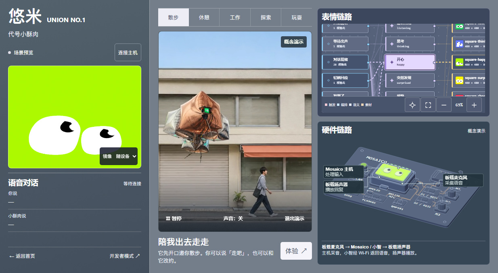
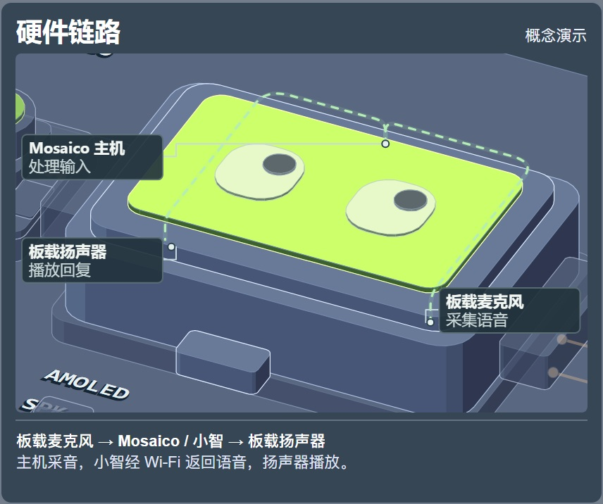
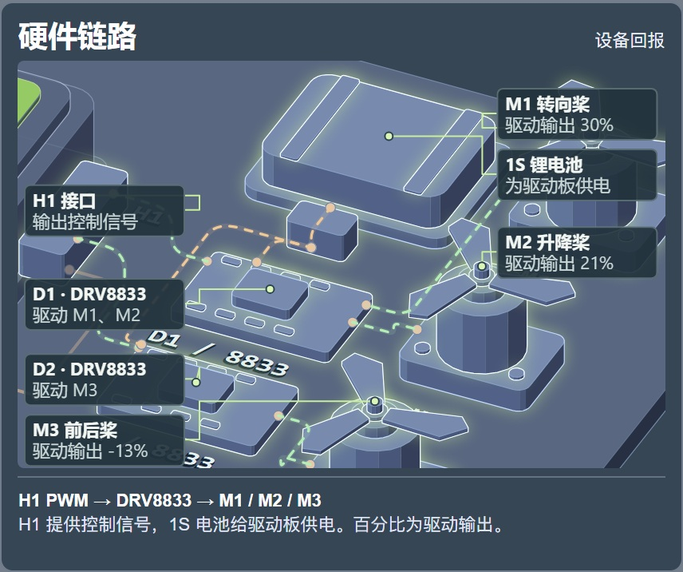

# UNION NO.1 · AirBoat Manual Control

**English** · [简体中文](README.zh-CN.md)

UNION NO.1 is a floating companion prototype. Its P1 landscape tablet interface brings five everyday scenes, an expression workbench, and an interactive Anatomy hardware diagram together on one screen. On a compatible Mosaico, the same interface can display the device’s expression frames, dialogue, and three motor outputs.



*The walking scene with its concept video, expression graph, and Anatomy board overview.*

## Try it locally

With Python 3.10 or newer, clone or download this repository, then run the following from its root.

```sh
cd walking-companion
python -B start-tablet.py
```

Press **Enter** at the device address prompt for a local preview. Open the URL printed in the terminal, choose **立即体验** (Open experience), select a scene, then tap **播放演示** (Play demo). The five bundled concept animations play locally and work without a Mosaico.

## Connect a Mosaico

1. Join the same phone hotspot on the computer, Mosaico, and landscape tablet.
2. On the Mosaico, open **控制 → 手机 → 开启遥控** (Control → Phone → Enable remote control). Enter the device URL shown on its screen into `start-tablet.py` on the computer.
3. Open the URL printed by the computer on the tablet. Tap **体验** (Try it) and enter the six-digit pairing code shown on the device. Return the device to its expression home screen.

**开发者模式** (Developer mode) in the lower-left opens the existing device console for manual control and stop functions. Full expression and dialogue sync needs firmware exposing the read-only `workbench` snapshot. The firmware patch documents the original integration against the 1.44.0 baseline. [Integration notes](walking-companion/EXPRESSION-LIVE-INTEGRATION.md) · [Reference firmware patch](walking-companion/firmware-integration/mosaico-p1-telemetry.patch)

## Follow the hardware path

The board labels identify the components. When a scene activates a route, the camera moves in and callouts identify each participating part before the view returns to the full board. Rounded dashes follow the isometric axes and move in the direction of transfer. Mint shows signals and control. Warm amber shows power.

| Voice path | Three motor branches |
| --- | --- |
|  |  |
| Microphone → Mosaico → speaker during a concept demo. | M1 yaw, M2 lift, and M3 fore/aft. The percentages are simulated drive outputs. |

## Project status

Edge checks at 1024 × 768 and 1234 × 678 covered the layout, local videos, hardware camera moves, and simulated pairing and telemetry. The AirBoat main project installed P1 telemetry with firmware 1.53.0 and verified startup health. The physical tablet-to-device hotspot test is pending.

- [Tablet launch and pairing guide (中文)](walking-companion/TABLET-START.zh-CN.md)
- [Anatomy model and hardware notes (中文)](walking-companion/tools/anatomy-parts.md)
- [Standalone expression preview source](expression-preview/index.html)
- [License](LICENSE)
