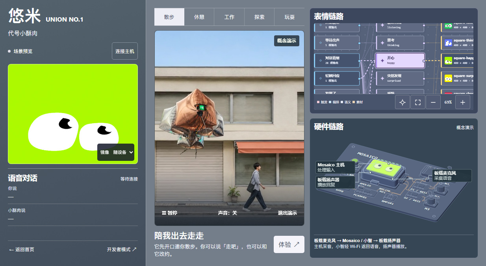
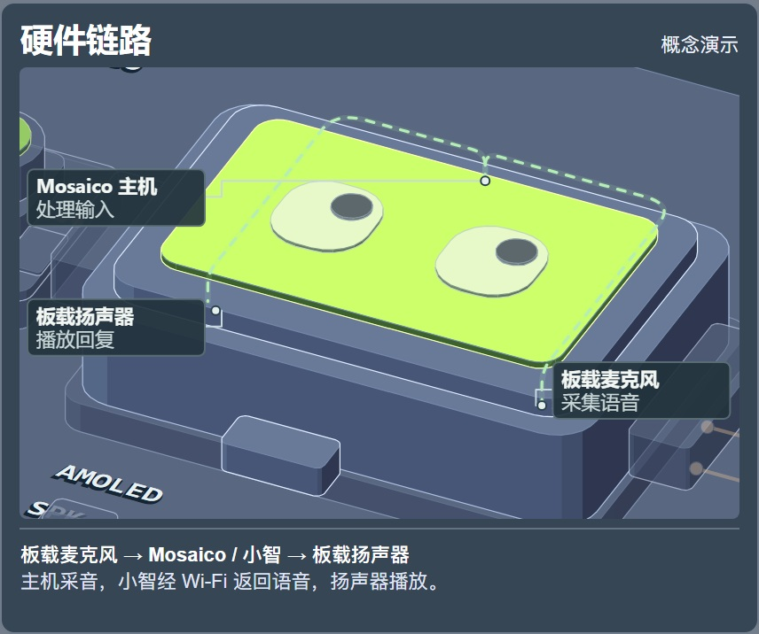
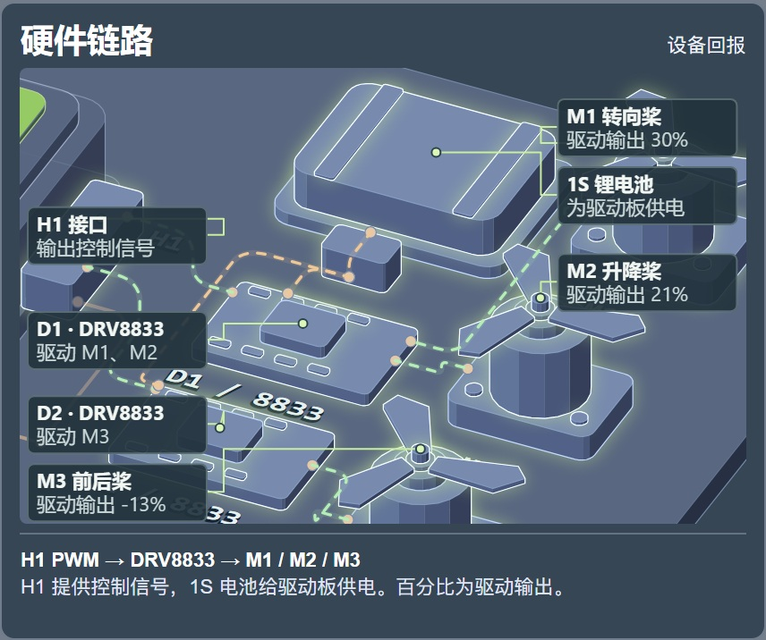

# 悠米 UNION NO.1 · AirBoat 手动控制

[English](README.md) · **简体中文**

悠米一号（代号小酥肉）是一个漂浮陪伴原型。P1 横屏平板页把五种生活场景、表情工作台和 Anatomy 硬件链路放在同一界面。连接兼容的 Mosaico 后，平板可显示设备当前的表情帧、对话文字和三路电机输出。



*散步场景的概念视频、表情链路和 Anatomy 硬件总览。*

## 在电脑上预览

安装 Python 3.10 或更新版本，克隆或下载本仓库，在仓库根目录运行以下命令。

```sh
cd walking-companion
python -B start-tablet.py
```

设备地址提示出现时直接按回车，打开终端显示的网址。点击「立即体验」，选择场景，再点击「播放演示」。随包附带的五段短片为概念动画，可在无 Mosaico 时本地播放。

## 连接 Mosaico

1. 让电脑、Mosaico 和横屏平板连接同一个手机热点。
2. 在主机打开「控制 → 手机 → 开启遥控」，把屏幕显示的设备网址填入电脑上的 `start-tablet.py`。
3. 平板打开电脑打印的网址。点击「体验」，输入主机显示的六位配对码，再回到主机的双眼首页。

左下角「开发者模式」可打开设备原有的手动控制和停止功能。实机表情和对话同步需要固件提供只读 `workbench` 快照。随附补丁记录 1.44.0 基线的早期接入方式。[固件接入说明](walking-companion/EXPRESSION-LIVE-INTEGRATION.md) · [参考固件补丁](walking-companion/firmware-integration/mosaico-p1-telemetry.patch)

## 看清硬件如何联动

部件名称刻在板面。场景触发链路时，镜头推近，悬浮标签说明各部件的作用，随后回到总览。圆角虚线贴合轴测方向，沿传递方向流动。薄荷色表示信号与控制，暖琥珀色表示供电。

| 语音链路 | 三路推进 |
| --- | --- |
|  |  |
| 概念演示中的板载麦克风 → Mosaico → 扬声器。 | M1 左右转向、M2 上下升降、M3 前后移动。百分比为模拟的驱动输出。 |

## 当前验证状态

在 Edge 的 1024 × 768 与 1234 × 678 横屏尺寸验证了布局、视频、硬件运镜和模拟配对遥测。AirBoat 主项目已随 1.53.0 固件安装 P1 遥测并核对启动健康，真实平板热点联测待完成。

- [平板启动与配对操作卡](walking-companion/TABLET-START.zh-CN.md)
- [Anatomy 结构和硬件说明](walking-companion/tools/anatomy-parts.md)
- [独立表情预览源码](expression-preview/index.html)
- [许可证](LICENSE)
